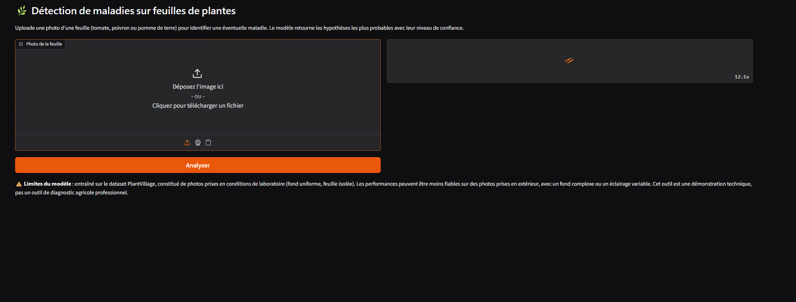
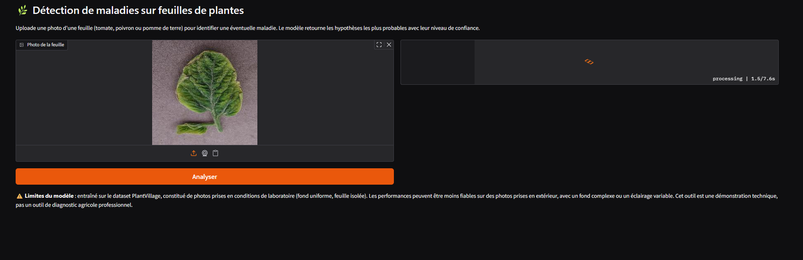
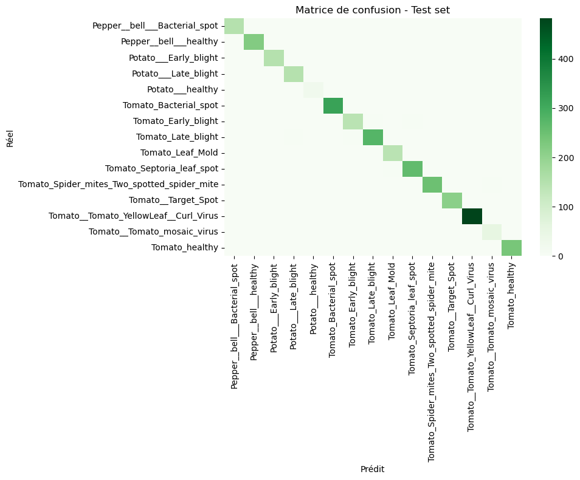

# 🌿 Détecteur de maladies sur feuilles de plantes

> Prends une photo d'une feuille de tomate, poivron ou pomme de terre, et le modèle te dit
> si elle est saine ou identifie la maladie la plus probable — en quelques secondes.





[](https://plant-sickness-tnlj.onrender.com)


**👉 [Essayer la démo en ligne](https://plant-sickness-tnlj.onrender.com)**

> ⏳ **Note sur l'hébergement** — Cette démo est déployée sur le tier gratuit de Render, un
> choix délibéré pour ce projet de portfolio (plutôt qu'une infrastructure de production).
> La capacité de calcul y est limitée : après une période d'inactivité, le service se met en
> veille et le premier chargement peut prendre 30 à 60 secondes le temps qu'il redémarre. Il
> est aussi possible que la démo soit temporairement plus lente ou momentanément indisponible
> en cas de pic de charge. Si c'est le cas, un simple rafraîchissement après une minute suffit
> généralement.

---

## 🧠 En bref

Ce projet est un classifieur d'images qui reconnaît **15 maladies** (+ état sain) sur des feuilles
de **tomate, poivron et pomme de terre**, à partir d'une simple photo. Le modèle utilise le
transfer learning (ResNet18 pré-entraîné) et atteint **99% d'accuracy** sur le jeu de test —
un résultat à interpréter avec prudence (voir la section [Limites](#️-limites-et-esprit-critique)).

Une interface web ([Gradio](https://www.gradio.app/)) permet de tester le modèle directement,
sans écrire une ligne de code.

---

## 📋 Sommaire

- [Le problème](#-le-problème)
- [Résultats](#-résultats)
- [Limites et esprit critique](#️-limites-et-esprit-critique)
- [Renforcer la robustesse : data augmentation](#-renforcer-la-robustesse--data-augmentation)
- [Comment ça marche](#️-comment-ça-marche)
- [Installation et utilisation](#-installation-et-utilisation)
- [Structure du projet](#-structure-du-projet)
- [Dataset](#️-dataset)
- [Pistes d'amélioration](#-pistes-damélioration)
- [Stack technique](#-stack-technique)

---

## 🌱 Le problème

Détecter une maladie sur une plante tôt permet d'agir avant qu'elle ne se propage. Dans un
contexte agricole, ce genre d'outil peut aider à un premier diagnostic rapide, en attendant
l'avis d'un professionnel. C'est aussi un bon cas d'usage pour explorer un pipeline complet
de computer vision : de la donnée brute jusqu'à une application déployée et accessible à tous.

## 📊 Résultats

Évalués sur un jeu de test de 3096 images, jamais vues pendant l'entraînement :

| Métrique | Score |
|---|---|
| Accuracy globale | 99% |
| F1-score (macro avg) | 0.99 |
| F1-score (classe la plus rare, *Potato — Sain*, 152 images) | 0.98 |



La gestion du déséquilibre des classes (jusqu'à 21x d'écart entre la classe la plus et la
moins représentée) via une loss pondérée a permis de maintenir de bonnes performances même
sur les classes minoritaires.

## ⚠️ Limites et esprit critique

Un score de 99% est excellent, mais aussi un signal à interroger plutôt qu'à célébrer
aveuglément. Le dataset utilisé ([PlantVillage](#️-dataset)) est constitué de photos prises
**en conditions de laboratoire** : fond uniforme, feuille isolée, éclairage contrôlé.

C'est une limite connue et documentée dans la littérature scientifique : des modèles entraînés
sur PlantVillage avec des scores proches de 99% voient souvent leurs performances chuter
significativement sur des photos de terrain réelles (fond complexe, éclairage variable, feuille
partiellement visible).

**Conclusion honnête** : ce projet démontre une maîtrise du pipeline de bout en bout —
exploration, entraînement, et déploiement d'une vraie application accessible en ligne — mais
n'est pas prêt pour un usage terrain sans ré-entraînement sur des données plus réalistes.

## 🔬 Renforcer la robustesse : data augmentation

Puisque la limite principale de ce projet vient d'un dataset "trop propre" (fond uniforme,
conditions de studio), la data augmentation est le levier le plus direct pour s'en rapprocher
d'un usage réel — sans avoir à collecter de nouvelles données. Quelques pistes concrètes,
au-delà des transformations légères déjà utilisées à l'entraînement (flip, rotation, jitter
de couleur) :

- **Random Erasing / Cutout** : masquer aléatoirement des zones rectangulaires de l'image
  pendant l'entraînement. Force le modèle à ne pas se reposer sur une seule zone ou un détail
  isolé pour classifier, et le pousse à apprendre des motifs plus distribués sur la feuille.
- **Remplacement de fond synthétique** : segmenter la feuille (via un modèle de segmentation
  ou simplement les masques déjà présents dans certaines variantes de PlantVillage) puis la
  recomposer sur des fonds variés (terre, autres feuilles, extérieur). Casse directement la
  corrélation "fond uniforme = photo de labo" que le modèle pourrait exploiter en raccourci.
- **Augmentations géométriques et photométriques plus poussées** : perspective aléatoire,
  flou de mouvement léger, variations d'exposition plus marquées — pour simuler la variabilité
  d'une photo prise au smartphone, en extérieur, par un utilisateur non expert.
- **Mixup / CutMix** : mélanger deux images (et leurs labels) pour créer des exemples
  d'entraînement synthétiques. Aide à lisser les frontières de décision entre classes visuellement
  proches (utile ici vu la confusion observée entre certains types de "blight" sur tomate).
- **Domain randomization plus poussée / GAN de style transfer** : générer des variantes
  stylisées des images d'entraînement (éclairage, texture) pour élargir artificiellement la
  diversité de conditions vues par le modèle.

**Pourquoi c'est intéressant à double titre :**

- *Pédagogique* : c'est l'occasion de manipuler concrètement la notion de **shortcut learning**
  (un modèle qui apprend un raccourci trompeur plutôt que le vrai signal), un piège classique en
  computer vision et un excellent sujet de discussion en entretien technique.
- *Professionnel* : en conditions réelles, les données disponibles sont rarement aussi propres
  et abondantes que dans un dataset académique comme PlantVillage. Savoir compenser ce genre de
  biais par de l'augmentation ciblée — plutôt que de simplement espérer plus de données — est une
  compétence directement transférable à des projets en entreprise, où la collecte de données
  supplémentaires est souvent coûteuse ou lente.

## ⚙️ Comment ça marche

1. **Exploration des données** (`01_exploration.ipynb`) — analyse de la distribution des
   classes, détection d'images corrompues, aperçu visuel.
2. **Entraînement** (`02_training.ipynb`) — transfer learning sur un ResNet18 pré-entraîné
   (ImageNet), avec loss pondérée pour compenser le déséquilibre des classes.
3. **Déploiement** (`app.py`) — interface Gradio qui charge le modèle et renvoie les 3
   hypothèses les plus probables avec leur score de confiance, hébergée sur Render.

## 🚀 Installation et utilisation

```bash
# Cloner le repo
git clone https://github.com/Nirvathec/plant-sickness.git
cd plant-sickness

# Installer les dépendances
pip install -r requirements.txt

# Lancer l'interface en local
python app.py
```

L'interface s'ouvre sur `http://127.0.0.1:7860`.

Pour ré-entraîner le modèle toi-même, télécharge le [dataset PlantVillage](#️-dataset), place-le
à la racine du projet, puis exécute les notebooks dans l'ordre (`01_exploration.ipynb` puis
`02_training.ipynb`).

## 📁 Structure du projet

```
plant-sickness/
├── README.md
├── requirements.txt
├── 01_exploration.ipynb   # Analyse du dataset
├── 02_training.ipynb      # Entraînement du modèle
├── app.py                 # Interface Gradio (déployée sur Render)
├── models/
│   └── best_model.pth     # Poids du modèle entraîné
├── PlantVillage/          # Dataset (non versionné, à télécharger séparément)
└── assets/
    └── ...                # Captures d'écran, gifs pour ce README
```

## 🗂️ Dataset

[PlantVillage](https://www.kaggle.com/datasets/emmarex/plantdisease) — environ 20 000 images
réparties sur 15 classes (maladies + état sain) pour la tomate, le poivron et la pomme de terre.

## 🔭 Pistes d'amélioration

- **Robustesse terrain** : ré-entraîner ou fine-tuner sur des photos prises en conditions
  réelles (fond complexe, extérieur) pour valider la limite identifiée ci-dessus.
- **Grad-CAM / explicabilité** : visualiser sur quelles zones de l'image le modèle se base
  pour décider — vérifierait s'il regarde bien les symptômes et pas le fond.
- **Élargir les espèces** : le dataset PlantVillage couvre d'autres cultures (maïs, raisin,
  pomme...) qui pourraient être intégrées.
- **Réduire le cold start** : passer sur un plan payant ou un hébergeur avec "always-on"
  pour éliminer le délai de réveil du service après inactivité.

## 🛠️ Stack technique

- **Modèle** : PyTorch (CPU), ResNet18 (via `timm`)
- **Traitement de données** : torchvision, Pillow
- **Évaluation** : scikit-learn
- **Interface** : Gradio
- **Visualisation** : Matplotlib, Seaborn
- **Déploiement** : Render (Web Service, tier gratuit)

---

*Projet réalisé dans le cadre de mon portfolio en data science / computer vision.*
*N'hésite pas à me contacter pour toute question : vergne.clement49@gmail.com*
